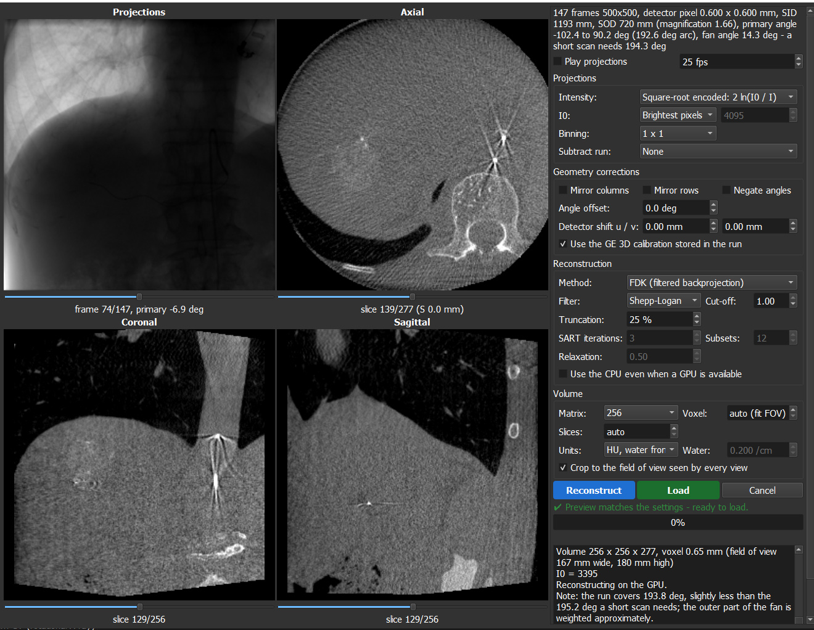

# DICOM Cone-Beam CT Reconstruction (3D Slicer)

Reconstructs rotational C-arm X-ray runs ("spins", e.g. GE Innova 3D / Siemens DynaCT / Philips XperCT
exports stored as one multi-frame XA or XRF DICOM object) into a 3D volume, straight from Slicer's
DICOM browser. It is the cone-beam counterpart of the DICOM SPECT Reconstruction plugin and follows
the same pattern: the run shows up as a loadable, and Load opens a reconstruction window with a preview.

> **Built on [PyTorch](https://pytorch.org/)** (through Slicer's [PyTorch extension](https://github.com/fepegar/SlicerPyTorch))
> and on the classic cone-beam CT literature. The reconstruction itself (FDK, short-scan weighting,
> forward projector and SART) is implemented in this extension; the methods are those of:
>
> - L. A. Feldkamp, L. C. Davis, J. W. Kress. *Practical cone-beam algorithm.* J. Opt. Soc. Am. A 1(6):612-619, 1984 (FDK).
> - D. L. Parker. *Optimal short scan convolution reconstruction for fan beam CT.* Med. Phys. 9(2):254-257, 1982,
>   and S. Wesarg, M. Ebert, T. Bortfeld. *Parker weights revisited.* Med. Phys. 29(3):372-378, 2002 (short-scan weights).
> - A. H. Andersen, A. C. Kak. *Simultaneous algebraic reconstruction technique (SART).* Ultrason. Imaging 6(1):81-94, 1984.
> - A. C. Kak, M. Slaney. *Principles of Computerized Tomographic Imaging.* IEEE Press, 1988 (ramp filter).
> - S. Umeyama. *Least-squares estimation of transformation parameters between two point patterns.*
>   IEEE TPAMI 13(4):376-380, 1991 (registration of the GE calibration to the header geometry).



## Use

1. Import the study into the DICOM database and select the XA series.
2. The run is offered as **"... run #N acquired HH:MM:SS CBCT"**. A run that holds several sweeps (GE
   "SUB SPIN" 3D DSA runs store a mask sweep and a contrast sweep in one object; the angle increments and
   frame times restart at the second sweep) gives one loadable per sweep, e.g. "run #14 sweep 1 (mask)" and
   "run #14 sweep 2 (contrast)".
3. Load opens the reconstruction window:
   - **Projections**: pixel encoding (square-root encoded, linear, or already logarithmic; chosen from
     `PixelIntensityRelationship`, GE raw frames are `SQRT`), I0 estimate, detector binning, and
     **Subtract run** (another sweep with the same trajectory, of this run or another run of the study, for
     3D DSA: contrast sweep minus mask sweep, in the line-integral domain).
   - **Geometry corrections**: mirror columns/rows, negate angles, angle offset, detector shift, and
     **Use the GE 3D calibration** (on when the run carries one, see below).
   - **Reconstruction**: FDK, FDK + SART refinement, or SART only; filter (Ram-Lak, Shepp-Logan, Cosine,
     Hann) and cut-off; lateral truncation correction; SART iterations/subsets/relaxation (defaults
     3 x 12 at 0.5 for refining FDK, 3 x 24 at 1.0 for SART only: more iterations or subsets and a larger
     relaxation give finer detail and more noise); **Use the CPU** even when a GPU is available (for a GPU
     without enough memory for the volume).
   - **Volume**: matrix, voxel size (auto = fit the field of view seen by every view), slices, output units:
     HU with the water value taken from the soft-tissue peak of the histogram (soft tissue = 40 HU, default),
     HU with a fixed water value, or attenuation in 1/cm. Subtracted volumes are given as contrast
     enhancement in HU (fixed water value).
4. Press **Reconstruct** and check the axial/coronal/sagittal previews; **Load** is enabled when the preview
   matches the settings on screen. The settings are stored on the volume as `CBCTRecon.*` attributes.

PyTorch is required and comes from Slicer's **PyTorch** extension (the module offers to install it). A GPU
makes FDK take seconds; on a 4-core CPU a 347-frame 500 x 500 run into a 256³ volume takes about 1.5 minutes.
SART on the CPU is slow: use 2 x 2 binning and a 128-192 matrix.

## Geometry

Read from the DICOM header, per frame:

| Quantity | Source |
| --- | --- |
| Gantry angles | `PositionerPrimaryAngle` + `PositionerPrimaryAngleIncrement` (and secondary), or the enhanced XA per-frame Positioner Position Sequence. Increments stored relative to the first frame (GE, Siemens) and per-frame steps are both recognised. |
| Distances | GE private block `GEMS_DL_IMG_01` (0019,xxBE source-detector, 0019,xxE9 source-isocenter) when present, otherwise `DistanceSourceToDetector` / `DistanceSourceToPatient` or the enhanced X-Ray Geometry Sequence. |
| Detector pixel | `ImagerPixelSpacing` (fallbacks: `PixelSpacing` at the isocenter, `FieldOfViewDimensions`). |
| Image orientation | `FieldOfViewRotation` / `FieldOfViewHorizontalFlip` are undone; collimator edges limit the area used for I0 and are padded. |

### GE 3D calibration

GE Innova raw runs carry the system's phantom calibration in the private block `GEMS_XR3DCAL_01`
(group 0021): one measured projection matrix per calibration position (about 150 over the sweep), in GE's
own frame (0.1 mm units) and for a 750 x 750, 0.4 mm calibration grid. These matrices describe the real
C-arm motion. On a sample GE run the principal point moves by about 15 mm along the sweep, which the
nominal angles cannot describe. The module ties the calibration frame to patient coordinates by fitting
the calibrated source positions to the nominal ones (rotation, scale, translation; about 1 mm RMS on that
run, scale 0.0994 mm per unit), converts the matrices to the stored frames' pixel grid and interpolates
them to every frame's angle. A calibration whose trajectory or scale does not match the header is not used.
GE's calibrated detector axes coincide with the nominal model's on that run, which also confirms the image
orientation convention below.

### Conventions

Angles are patient based as in DICOM: primary positive towards LAO, secondary positive towards CRA. At
0/0 the tube is under the table (AP view), image columns run to the patient's left and rows to the feet.
The volume is in patient coordinates with the isocenter at the origin.

Vendors do not all store the frames the same way. If the result looks wrong:

- blurred or doubled everywhere: tick **Mirror columns**;
- head and feet swapped: **Mirror rows**;
- left-right mirror image of the patient: **Negate angles**;
- small dense objects (coils, clips, contrast-filled vessels) look like small rings or arcs: tune
  **Detector shift u** in 0.5 mm steps.

## Method

- Line integrals `p = ln(I0/I)` (`2 ln(I0/I)` of the pixel values for square-root encoded frames), I0 from
  the 99.9th percentile of the collimated area (per run, per frame or fixed).
- FDK on the real detector geometry of every frame (voxel-driven backprojection with bilinear
  interpolation), cosine pre-weighting, ramp filter built in the spatial domain with apodisation,
  Parker short-scan weights generalised to over-scan (`delta = (scan range - 180°) / 2`), and cosine
  extension of truncated detector rows. Voxels not seen by the whole scan are set to zero.
- SART: ray-driven forward projector (trilinear sampling), interleaved ordered subsets, non-negativity.

C-arms are not perfectly rigid. Without a stored calibration (for example "Processed" exports), the nominal
angles are used and the result is less sharp than the vendor's own 3D. Frames exported with
`PixelIntensityRelationship = DISP` are display-processed, so attenuation values are relative.

## Tests

Synthetic data only (analytic ellipsoid phantom, synthetic DICOM run - no patient data):

```
cd DICOMCBCTRecon
python -m unittest discover -s Testing/Python -v
```

Inside Slicer the module self test (`DICOMCBCTReconTest`) writes a synthetic run, reads it back and checks
the reconstructed attenuation.

## Layout

```
CMakeLists.txt                 extension (depends on the PyTorch extension)
DICOMCBCTRecon/
  DICOMCBCTRecon.py            hidden module, DICOM plugin, logic for scripting, self test
  DICOMCBCTReconLib/
    xadata.py                  DICOM header -> geometry, sweeps, GE calibration block, frames (pydicom)
    gecalib.py                 GE calibration matrices -> per-frame matrices in patient coordinates
    geometry.py                C-arm projection geometry, reconstruction grid
    reconstruction.py          line integrals, FDK + Parker, forward projector, SART (PyTorch)
    phantom.py                 analytic phantom and synthetic DICOM runs for the tests
    display.py                 in-memory previews (shared approach with the SPECT plugin)
    dialog.py                  reconstruction window
  Testing/Python/              unit tests (no Slicer needed)
  Resources/Icons/
```

Without building, add the `DICOMCBCTRecon` folder (the inner one) to *Edit > Application Settings > Modules >
Additional module paths* and restart Slicer.
